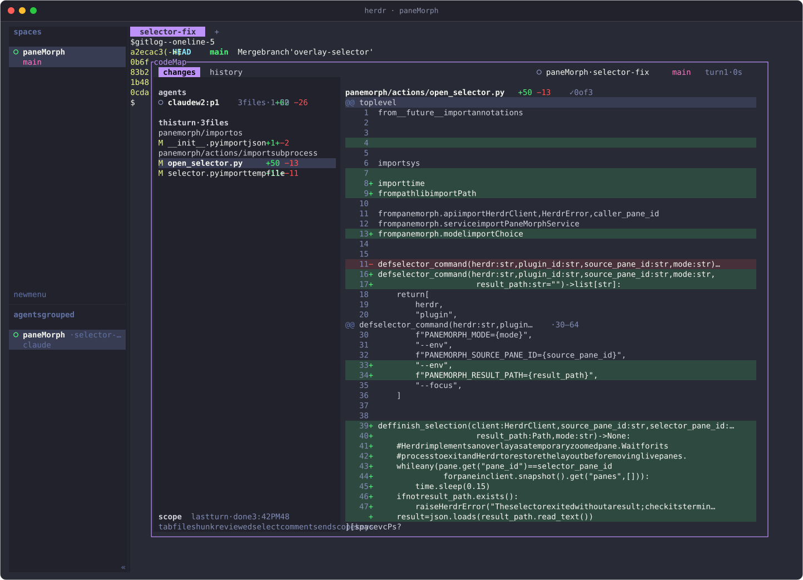
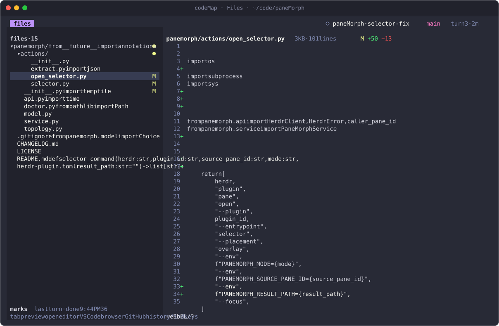
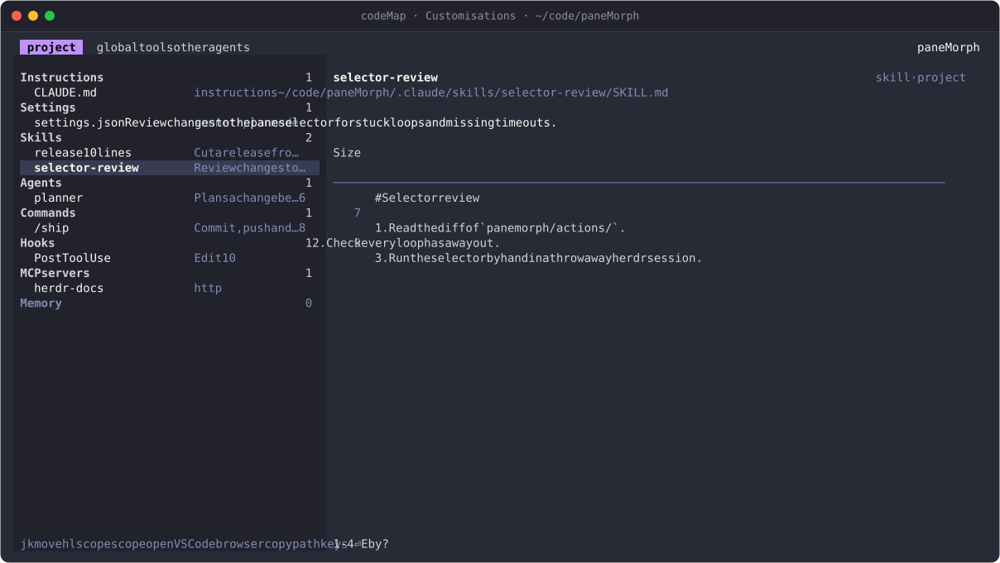
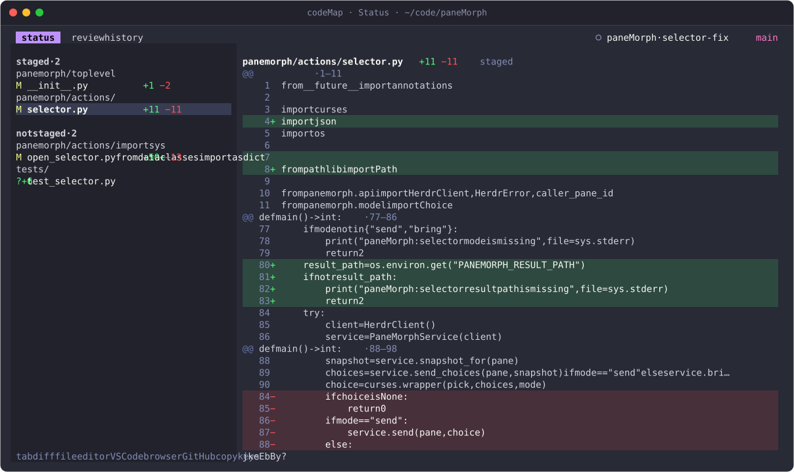
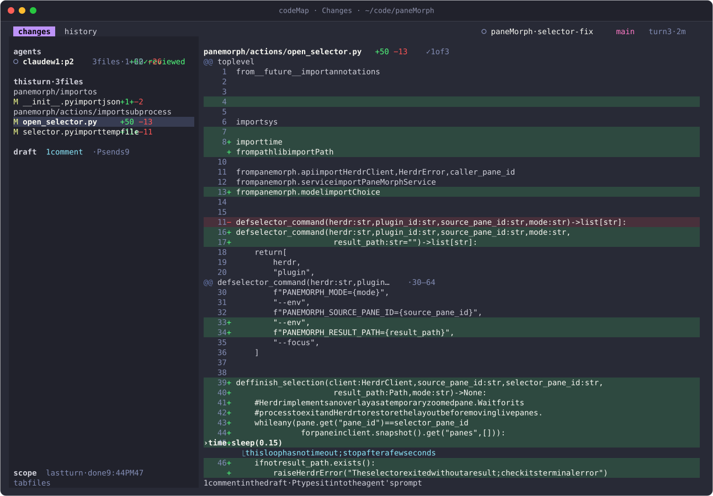
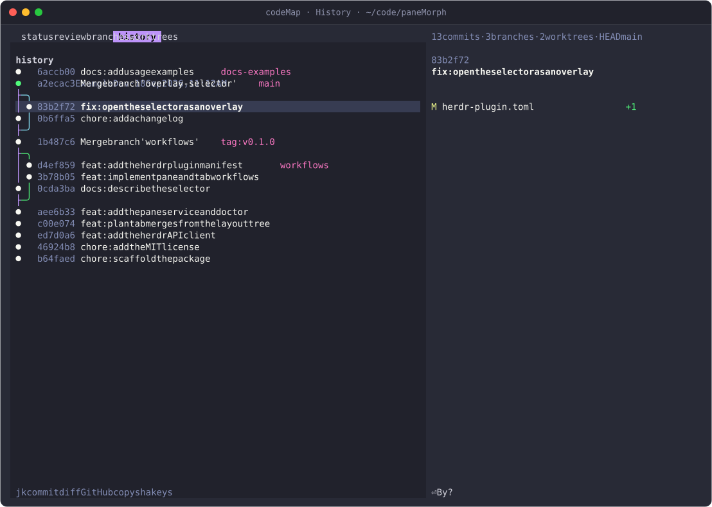
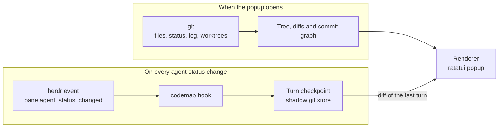

<div align="center">

# codeMap

**Your agents' files, what they changed, and what they run with.**

[](https://github.com/Jenish-Shobhit/codeMap/actions/workflows/ci.yml)
[](https://scorecard.dev/viewer/?uri=github.com/Jenish-Shobhit/codeMap)
[](https://github.com/Jenish-Shobhit/codeMap/releases/latest)
[](LICENSE)
[](https://herdr.dev)
[](https://www.rust-lang.org)

[Install](#install) · [Keybindings](#keybindings) · [Usage](#usage) · [How it works](#how-it-works) · [FAQ](#troubleshooting-and-faq) · [Contributing](CONTRIBUTING.md) · [Changelog](CHANGELOG.md)

</div>

<p align="center">
  
  <br>
  <sub>codeMap over an agent's pane, captured from a real herdr client.</sub>
</p>

## Why

Coding agents change more code in a turn than anyone reads line by line.
codeMap is a [herdr](https://herdr.dev) plugin that opens over the agent you are
watching and shows its worktree as a file tree with what the last turn touched,
the turn itself as a reviewable diff, what is staged and what is not, and the
repository's history as a graph, so you see what just changed and answer it
without leaving the terminal.

## Features

- **Popups over the agent you are watching.** One key opens the file tree,
  another the Git popup with the working tree's status, the review of the
  last turn and the history, a third the skills, hooks and settings the agent
  runs with.
- **Open anything where you work.** `e` opens the file in neovim in a split
  beside the agent, `E` in VS Code, `b` in the browser and `B` on GitHub.
- **Turn-aware.** An event hook snapshots the worktree whenever an agent starts
  or finishes a turn, so the tree marks and the diff show what the last turn
  did, not only what differs from `HEAD`.
- **Review without leaving the terminal.** Mark hunks reviewed, comment on
  lines, and send the comments to the agent's prompt as one message.
- **Read-only.** Checkpoints live in codeMap's own state directory. Your
  repository gets no refs, no stash and no index changes.
- **Fast.** The frame paints in under a millisecond, before git is read.
- **Follows herdr's theme**, including all 18 built-in palettes and custom
  colours.
- **Works outside herdr too:** `codemap [path]` opens the same views in any
  terminal.

## Requirements

- [herdr](https://herdr.dev) 0.9.0 or newer, on macOS or Linux.
- `git` on your `PATH`.
- To install from GitHub, herdr builds codeMap with `cargo`, which needs Rust
  1.90 or newer ([rustup](https://rustup.rs)) and the linker it uses: Xcode's
  command line tools on macOS, `gcc` or `clang` on Linux. The
  [prebuilt binaries](#prebuilt-binaries) need neither.
- For the ⌃⌥M chord, a terminal with the Kitty keyboard protocol, such as
  Ghostty or kitty. Other chords work in any terminal; see the
  [FAQ](#m-does-nothing-or-arrives-as-).

## Install

### From GitHub

```sh
herdr plugin install Jenish-Shobhit/codeMap
```

herdr previews the manifest and its build command (`cargo build --release`)
before it runs anything. Add `--ref v0.1.0` to pin a release, or `--yes` to
skip the prompt. Then [bind a key](#keybindings) and check the plugin:

```sh
herdr plugin list                               # dev.codemap, enabled
herdr plugin action list --plugin dev.codemap   # open, files, customisations, git, changes, history
```

To update, run the install command again; herdr replaces its checkout. To
remove codeMap, run `herdr plugin uninstall dev.codemap`.

### From a local checkout

```sh
git clone https://github.com/Jenish-Shobhit/codeMap
cd codeMap
cargo build --release        # `herdr plugin link` does not run build steps
herdr plugin link "$PWD"
```

The manifest runs `target/release/codemap` from the plugin directory, so
rebuild after you pull. `herdr plugin unlink dev.codemap` removes the plugin
and leaves the files.

### Prebuilt binaries

Every [release](https://github.com/Jenish-Shobhit/codeMap/releases/latest) has
archives for macOS (`aarch64-apple-darwin`, `x86_64-apple-darwin`) and static
Linux binaries (`aarch64-unknown-linux-musl`, `x86_64-unknown-linux-musl`).
Each archive is a ready-to-link plugin directory. Extract it somewhere
permanent, since herdr runs the binary from there:

```sh
v=v0.1.0 t=aarch64-apple-darwin      # or x86_64-apple-darwin, *-unknown-linux-musl
u=https://github.com/Jenish-Shobhit/codeMap/releases/download/$v
curl -LO "$u/codemap-$v-$t.tar.gz" -LO "$u/codemap-$v-$t.tar.gz.sha256"
shasum -a 256 -c "codemap-$v-$t.tar.gz.sha256"   # sha256sum -c on Linux
tar -xzf "codemap-$v-$t.tar.gz"
herdr plugin link "$PWD/codemap-$v-$t"
```

## Keybindings

codeMap declares six herdr actions. Bind the ones you want in
`~/.config/herdr/config.toml`:

```toml
[[keys.command]]
key = "ctrl+alt+m"
type = "plugin_action"
command = "dev.codemap.open"
description = "codeMap: what the focused agent changed"

[[keys.command]]
key = "ctrl+alt+f"
type = "plugin_action"
command = "dev.codemap.files"
description = "codeMap: the focused agent's files"

[[keys.command]]
key = "ctrl+alt+k"
type = "plugin_action"
command = "dev.codemap.customisations"
description = "codeMap: what the focused agent runs with"

[[keys.command]]
key = "ctrl+alt+g"
type = "plugin_action"
command = "dev.codemap.git"
description = "codeMap: git status of the focused agent's worktree"
```

Then run `herdr config check` and `herdr server reload-config`.
`dev.codemap.open` and `dev.codemap.changes` open the Git popup on the review
of the last turn, `dev.codemap.git` on the working tree's status and
`dev.codemap.history` on the commit graph. `dev.codemap.files` opens the file
tree, and `dev.codemap.customisations` the agent's setup.

Inside the popup:

| Keys | Where | Action |
| --- | --- | --- |
| `e` / `E` | Files, Customisations, Status, Review | open the file at the line in the editor, in a split beside the agent / in VS Code |
| `b` / `B` | Files, Customisations, Status, Review | open the file in the browser / on GitHub |
| `y` | Files, Customisations, Status, Review | copy `path:line` |
| `s` / `a` | Files, Review | what counts as changed: last turn, the agent's session, since `HEAD` / next agent |
| `tab` | Files, Status, Review | move between the list and the body |
| `p` / `T` | inside herdr | pin codeMap as a split that follows the focused pane / open it in its own tab |
| `?` | everywhere | show every key |
| `q` or `⎋` | everywhere | close |
| `j` `k`, `l` `h` | Files | move through the tree, open or close a folder |
| `⏎` | Files | open a folder, or a file in the editor |
| `/` | Files | find a file by name; `↑` `↓` pick, `⏎` go |
| `1` `2` `3` `4` | Customisations | project, global, tools, other agents |
| `j` `k`, `h` `l`, `⏎` | Customisations | move through the list, change scope, open the file in the editor |
| `1` `2` `3` | Status, Review, History | Status, Review, History |
| `j` `k`, `tab`, `⎋` | Status | move through the staged and not staged files, read the selected file's diff, go back to the files |
| `j` `k`, `]` `[`, `}` `{` | Review | next or previous line, hunk, file |
| `space` | Review | mark the hunk reviewed (kept until the hunk changes) |
| `v`, `c`, `x` | Review | select lines, comment on them, delete a comment |
| `P` / `S` | Review | type the draft into the agent's prompt and close / submit it through herdr's `agent.prompt` |
| `j` `k`, `⏎`, `⌫` | History | move between commits, show the diff, go back |

The editor is `$VISUAL`, then `$EDITOR`, then `nvim` when it is installed.
Inside herdr it opens in a split beside the agent's pane and the popup closes;
outside herdr it takes over the terminal until you quit it. The browser is
Chrome, then Safari, on macOS, and your default browser on Linux;
`CODEMAP_BROWSER` names another.

The popup takes every key while it is open: nothing reaches herdr or the agent
until it closes.

## Usage

Press ⌃⌥M over an agent's pane. codeMap opens a popup at 94% × 92% on that
pane's working directory: its foreground cwd, so it follows an agent that
changed directory, and otherwise its herdr worktree. The header names the
workspace, tab, branch and turn, as in `○ paneMorph · selector-fix  main  turn 3 · 2m`.

The screenshots show [paneMorph](https://github.com/Jenish-Shobhit/paneMorph)'s
code with one recorded agent turn. They are rendered from the real UI by
`cargo run --example screenshots`, and CI checks that they are current. The
image at the top is a capture of a real herdr client in a throwaway session
(`-- --herdr`).

### Files



The worktree as a tree, with the selected file's contents beside it. Files the
last turn touched carry `M`, `A` or `R`, their folders a `●`, and the preview
puts a `+` beside each line the turn added. The popup opens on the first
changed file. `/` finds a file by name, and a folder shows what changed inside
it. Ignored files stay out of the tree.

### Customisations



What the agent in front of you runs with, read from the files that define it.
Four scopes, on `1` to `4`:

| Scope | Shows |
| --- | --- |
| project | `CLAUDE.md`, settings, skills, agents, commands, hooks, MCP servers and memory of this repository |
| global | the same from `~/.claude`, with plugins |
| tools | the configuration of herdr, yazi, neovim, ghostty, kitty, tmux, your shell and git |
| other agents | `AGENTS.md`, Cursor rules and Copilot instructions in the repository, and Codex, Cursor and Gemini in your home folder |

A kind with nothing in it still shows, with a `0`, so you see what is not set
up. The popup opens on the project when the repository has a `.claude` folder
or a `CLAUDE.md`, and on global otherwise. Backup copies such as
`config.toml.bak` are counted, not listed.

It shows names, descriptions and counts. It never shows the values of
environment variables, the arguments or addresses of MCP servers beyond the
host, or any line of a shell or tool configuration file.

### Status



The first tab of the Git popup: what `git status` reports, as two lists.
**staged** is the index against `HEAD`, and **not staged** is the working tree
against the index, with untracked files marked `?`. A file that is partly
staged is in both lists, each time with its own diff. `j` and `k` move through
both lists, `tab` steps into the selected file's diff and `⎋` comes back. `2`
and `3` switch to Review and History.

Status is read-only for now: it shows what is staged and what is not, and
does not stage, unstage, discard or commit anything.

### Review



The agent's last turn, file by file and hunk by hunk, on the `review` tab
(`dev.codemap.changes`, or `--view changes`). `s` widens the scope to
the agent's whole session, then to everything since `HEAD`. `space` marks a
hunk reviewed; the mark stays until the hunk changes. Select lines with `v`,
press `c`, and write a comment. `P` types the draft into the agent's prompt as
one message for you to send:

```text
Review comments from codeMap:

panemorph/actions/open_selector.py:43-45 — this loop has no timeout; stop after a few seconds
```

`S` submits it straight away through herdr's `agent.prompt`. If the agent is
waiting on a question, codeMap says so and keeps the draft.

### History



The commit graph with branches, tags and `HEAD`, and the repository's worktrees
with the herdr agents working in each (`●` working, `○` idle). `⏎` shows a
commit's diff.

## Standalone

The binary runs without herdr:

```sh
codemap                          # the current directory
codemap path/to/repo --view files
codemap doctor                   # where codeMap looks for herdr, its theme and state
codemap --help
```

It is `target/release/codemap` in the plugin directory; link it onto your
`PATH` to use it anywhere. Outside herdr there is no focused agent, so Review
starts at "since `HEAD`"; turns the hook recorded in that repository are still
one `s` away. Pinning (`p`, `T`) and sending comments need herdr.

## Configuration and theme

codeMap has no settings file of its own; it follows herdr.

- **Keys:** the `[[keys.command]]` entries above.
- **Theme:** herdr has no theme API, so codeMap reads `[theme]` from herdr's
  `config.toml` (`name`, `auto_switch` with `dark_name`, `[theme.custom]` and
  `[theme.custom.dark]`) and resolves it the way herdr does, with herdr's 18
  built-in palettes. With `auto_switch`, codeMap cannot see the host's
  appearance and uses the dark theme. The screenshots use `name = "dracula"`
  with `sidebar_bg = "#21222c"`.
- **Paths:** herdr's config comes from `HERDR_CONFIG_PATH`, else
  `$XDG_CONFIG_HOME/herdr/config.toml`, else `~/.config/herdr/config.toml`.
  Turn checkpoints go to the plugin state directory herdr assigns
  (`~/.local/state/herdr/plugins/dev.codemap/` by default);
  `CODEMAP_STATE_DIR` overrides it.

## How it works



**Reading the repository.** The popup paints its frame first, then worker
threads ask git for the files it tracks or does not ignore, the diff in scope,
what is staged and what is not, the commit log and the worktrees. The commit
graph is laid out in lanes and drawn with box characters. A file's preview
reads at most its first 512 KB. Hunks are named by the function line git
prints in each hunk header.

**Recording turns.** herdr runs `codemap hook` on every
`pane.agent_status_changed` event. A change to `working` starts a turn; a
change from `working` to `idle`, `done` or `blocked` ends it, and answering a
question (`blocked` to `working`) continues the same turn. Each boundary
snapshots the worktree into a shadow git directory, and the diff between the
two snapshots is the turn. The hook takes about 60 ms, and the last 50 turns
per agent are kept.

| Measured on an Apple silicon Mac, release build | Time |
| --- | --- |
| Process start to first paint | 0.6 ms in process, full frame 5 ms after spawn |
| History of 2,000 commits | about 20 ms |
| Hook, per turn boundary | about 60 ms |

## Privacy and safety

**codeMap never writes into your repository.** No refs, no stash, no index
changes, no objects.

- Snapshots go to a shadow git directory in the plugin's state directory
  (`…/dev.codemap/repos/<repo>/shadow.git`), with its own objects, index and
  refs, and your worktree as its work tree.
- Commands that write objects never see your object store, so git cannot
  "freshen" (touch) objects in it. Read-only diffs borrow it for one process
  through `GIT_ALTERNATE_OBJECT_DIRECTORIES`.
- The "since `HEAD`" diff and the Status tab read a private copy of your
  index.
- The test suite fingerprints every file under `.git` before and after each
  operation, and fails on any change.
- codeMap makes no network requests. It talks only to the local herdr socket,
  and sends text to an agent only when you press `P` or `S`.

Reviewed marks and unsent comments are stored next to the checkpoints. Delete
the state directory to forget them.

## Troubleshooting and FAQ

### ⌃⌥M does nothing, or arrives as ⌥⏎

Without the Kitty keyboard protocol, ⌃M is the same byte as Return, so ⌃⌥M
reaches herdr as ⌥⏎. Use a terminal that supports the protocol, such as
Ghostty or kitty, or bind a chord every terminal can send, such as
`prefix+m`:

```toml
[[keys.command]]
key = "prefix+m"
type = "plugin_action"
command = "dev.codemap.open"
description = "codeMap: what the focused agent changed"
```

### The first launch after a build is slow

On macOS the first run of a newly built binary takes about 0.7 s while the
system checks it; later launches paint in milliseconds. If you downloaded a
release archive with a browser and macOS refuses to run it, clear the
quarantine flag: `xattr -dr com.apple.quarantine codemap-v0.1.0-*`.

### Review shows "since HEAD", not the last turn

No turn has been recorded for this agent yet: the hook starts recording once
the plugin is installed, at the agent's next turn. Until then the scope is
"since `HEAD`"; press `s` to cycle scopes.

### Where do I look when something fails?

- `codemap doctor` prints the herdr socket, config, theme, state directory and
  how many agents have turns in the current repository.
- `herdr plugin log list --plugin dev.codemap` shows each action and hook run
  with its output.
- `herdr plugin list` shows whether the plugin is enabled and any manifest
  warnings.

### The install fails at `cargo build`

The GitHub install builds from source and needs `cargo` 1.90+ and its linker
on the `PATH` that herdr sees. Install them, or use a
[prebuilt binary](#prebuilt-binaries).

## Roadmap

Ideas under consideration, not commitments:

- Step through earlier turns, not only the last one and the session.
- Staging, committing and switching branches from the Git popup.
- Follow the host's light or dark appearance when herdr's `auto_switch` is on.

Suggestions are welcome in [issues](https://github.com/Jenish-Shobhit/codeMap/issues).

## Contributing

Bug reports and fixes are welcome. [CONTRIBUTING.md](CONTRIBUTING.md) covers
the setup, the checks CI runs, the snapshot tests and how to run the live
tests against a throwaway herdr server. `main` changes
only through pull requests that pass CI. Everyone taking part follows the
[Code of Conduct](CODE_OF_CONDUCT.md).

## Security

Please report vulnerabilities privately through
[GitHub's private vulnerability reporting](https://github.com/Jenish-Shobhit/codeMap/security/advisories/new);
see [SECURITY.md](SECURITY.md).

## License

codeMap is released under the [MIT License](LICENSE). Copyright (c) 2026
Jenish Shobhit.

[NOTICE](NOTICE) lists third-party material: the colour palettes ported from
herdr (Apache-2.0) and the Rust crates the binaries include.

---

Sibling project: [paneMorph](https://github.com/Jenish-Shobhit/paneMorph)
moves live herdr panes between tabs without restarting their processes.
